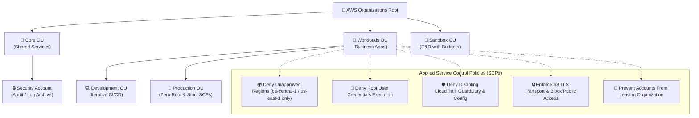
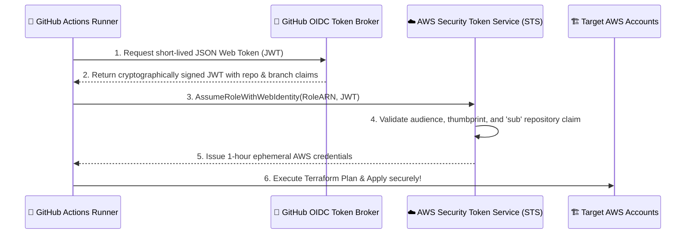

# AWS Enterprise Multi-Account Landing Zone & Security Guardrails 🛡️☁️

> **Production-grade multi-account governance platform** built with modular Terraform, AWS Organizations, preventative Service Control Policies (SCPs), and GitHub Actions OIDC federation with zero static credentials.

[](https://github.com/TarunKumarPardeshi/aws-enterprise-landing-zone/actions/workflows/ci.yml)
[](https://www.terraform.io/)
[](https://aws.amazon.com/organizations/)
[](https://www.cisecurity.org/)
[](https://opensource.org/licenses/MIT)

---

## 📖 Overview

As engineering teams scale, managing security, billing, and access in a single AWS account leads to blast-radius disasters and compliance breaches.

**AWS Enterprise Landing Zone** establishes an automated multi-account landing zone implementing the AWS Well-Architected Framework:
1. **Organizational Unit (OU) Segmentation**: Strict isolation between Core (Security & Audit), Workloads (Production & Development), and Sandbox accounts.
2. **Deterministic Preventative Guardrails (SCPs)**: Unbypassable account-level restrictions that deny unapproved regions, kill root account activity, protect security logs, and enforce encryption in transit.
3. **Zero Static Credentials**: Eliminates long-lived `AWS_ACCESS_KEY_ID` secrets via GitHub Actions OIDC federated trust.
4. **Sovereign Region Confinement**: Restricts deployments strictly to authorized regions (`ca-central-1` and `us-east-1`) while permitting required global control planes.

---

## 🏗️ Organizational Hierarchy & Architecture



---

## 🛡️ Service Control Policy (SCP) Catalog

| Policy Identifier | Target | Security Objective |
|---|---|---|
| `SCP-DenyUnapprovedRegions` | `Workloads` OU | Restricts AWS API requests strictly to `ca-central-1` and `us-east-1`, blocking unauthorized regions to reduce attack surface and prevent data sovereignty violations. |
| `SCP-DenyRootUser` | `Workloads` OU | Completely denies all API and console actions initiated by account root credentials, forcing IAM Identity Center / SSO role assumption. |
| `SCP-ProtectSecurityInfrastructure` | `Workloads` OU | Denies destructive actions against CloudTrail, AWS Config rules, and GuardDuty detectors even by account administrators. |
| `SCP-EnforceS3Security` | `Workloads` OU | Enforces `aws:SecureTransport` (HTTPS) on all S3 buckets and blocks unauthorized deletion of Account Public Access Block. |
| `SCP-DenyLeavingOrganization` | `Workloads` OU | Prevents member accounts from disconnecting themselves from central governance. |

---

## 🔑 Zero-Static-Credential CI/CD Architecture (OIDC)

Traditional CI/CD pipelines store long-lived IAM user secret keys that are prone to leaks. This Landing Zone deploys an **AWS IAM OpenID Connect (OIDC)** provider directly trusting GitHub Actions tokens:



---

## 🚀 Deployment Instructions

### 1. Prerequisites
- Terraform `>= 1.5.0` installed
- AWS Management account with administrator permissions

### 2. Configure Variables
Copy the example variables file:
```bash
cd environments/prod
cp terraform.tfvars.example terraform.tfvars
```

Update `terraform.tfvars`:
```hcl
aws_region       = "ca-central-1"
environment      = "prod"
approved_regions = ["ca-central-1", "us-east-1"]
github_user      = "TarunKumarPardeshi"
```

### 3. Deploy
```bash
terraform init
terraform plan -out=tfplan
terraform apply tfplan
```

---

## 🔬 Automated Testing & Verification

Run the Python unit test harness to mathematically verify the SCP condition operators and IAM trust boundaries:

```bash
pytest tests/ -v
```

```
tests/test_scp_policies.py::test_scp_file_exists PASSED
tests/test_scp_policies.py::test_root_user_denial_logic PASSED
tests/test_scp_policies.py::test_s3_insecure_transport_denial PASSED
tests/test_scp_policies.py::test_github_oidc_trust_policy PASSED
============================== 4 passed in 0.02s ==============================
```

---

## 📂 Repository Structure

```
├── .ci/workflows/ci.yml        # Automated Terraform lint & test workflow
├── environments/
│   └── prod/                   # Root deployment environment
│       ├── main.tf             # Master orchestration linking modules
│       ├── variables.tf        # Environment parameters
│       ├── outputs.tf          # Exported account and role ARNs
│       └── terraform.tfvars.example
├── modules/
│   ├── organizations/          # AWS Organizations & OU tree
│   ├── scp_guardrails/         # 5 Production Service Control Policies
│   └── iam_oidc_github/        # GitHub Actions OIDC IAM federation
├── tests/
│   └── test_scp_policies.py    # Python policy validation test suite
└── README.md
```

---

## 👨‍💻 Author

**Tarun Kumar Pardeshi** — Cloud & DevOps Engineer
- GitHub: [@TarunKumarPardeshi](https://github.com/TarunKumarPardeshi)
- LinkedIn: [tarun-pardeshi](https://www.linkedin.com/in/tarun-pardeshi/)
